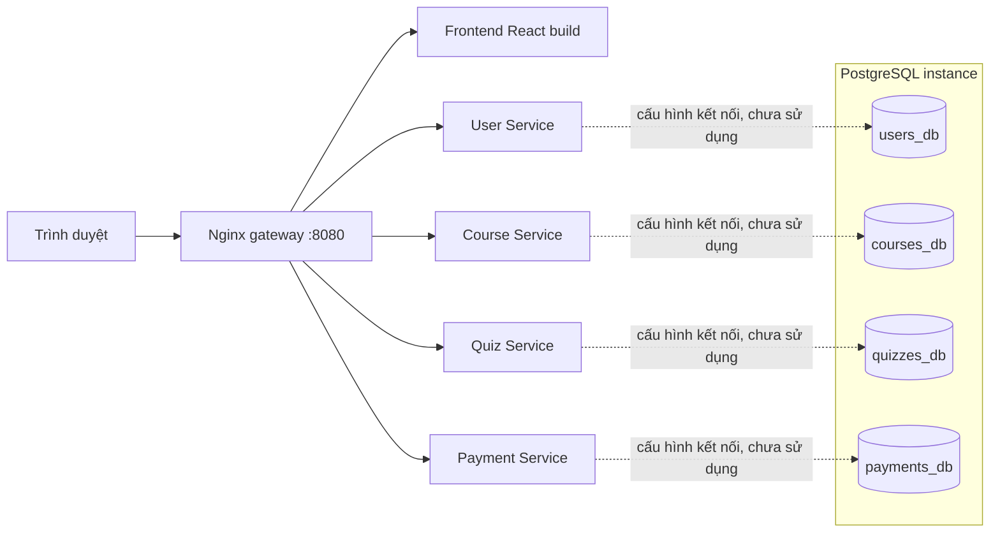

# Nền tảng học trực tuyến theo kiến trúc Microservices

Dự án cuối kỳ môn Điện toán đám mây của nhóm 3 thành viên.
Repository nhóm: [moseking/CloudComputing_OLP](https://github.com/moseking/CloudComputing_OLP).
Bản hiện tại là **bộ khung 0.1.0** để các thành viên phát triển song song.

Đọc nhanh: [Trạng thái](#status) · [Kiến trúc](#architecture) · [Cấu trúc](#structure) ·
[Phân công](#roles) · [Chạy Docker](#docker) · [Phát triển và test](#development) ·
[Hợp đồng API](#api-contracts) · [Database](#database) · [GitHub](#github) ·
[Xử lý lỗi](#troubleshooting) · [Kế hoạch cloud](#cloud).

<a id="status"></a>

## Trạng thái hiện tại

| Thành phần | Đã có trong bộ khung | Chưa triển khai |
| --- | --- | --- |
| Frontend | React + Vite, khu vực 4 dịch vụ, nút gọi health, tải khóa học demo, liên kết Swagger | Form tài khoản, routing nghiệp vụ, giao diện học/làm bài/thanh toán |
| User | Health, Swagger, schema request, lỗi có cấu trúc | Đăng ký, đăng nhập, JWT, hồ sơ: trả HTTP 501 |
| Course | Hai khóa học demo trong bộ nhớ, chi tiết và lỗi 404 | Đăng ký học: 501; chưa lưu DB |
| Quiz | Một bài demo, không công khai đáp án đúng | Nộp bài/chấm điểm: 501; chưa lưu DB |
| Payment | Schema nhận số tiền demo, từ chối trường thẻ ngoài hợp đồng | Tạo/đọc giao dịch: 501; chưa có PENDING/SUCCESS/FAILED |
| Hạ tầng | Dockerfile, Compose, Nginx, script tạo 4 DB và 4 tài khoản riêng | Chưa chạy toàn bộ stack bằng Docker; chưa deploy cloud |

`demo: true` đánh dấu dữ liệu mẫu. HTTP 501 là kết quả chủ ý cho nghiệp vụ chưa làm,
không phải thành công. `/health` chỉ xác nhận tiến trình đang trả lời, không kiểm tra DB.

**Mức kiểm chứng ngày 28/10/2026:** test Python và build frontend đã chạy trực tiếp trên Windows;
routing đã được kiểm tra bằng Nginx Windows với upstream local. Cấu hình Compose kiểm tra được
bằng CLI với `.env.example`, nhưng Docker Desktop hiện báo không khởi động được daemon.
Chưa xác nhận build image, Compose runtime, PostgreSQL hoặc mạng Docker. Các lệnh chạy Docker
dưới đây là quy trình cần thực hiện khi Docker Desktop hoạt động; chưa có bằng chứng deploy cloud.

<a id="architecture"></a>

## Kiến trúc



Trình duyệt gọi API qua Nginx cùng origin. Nginx giữ nguyên `/api/...` khi chuyển đến
FastAPI phù hợp và chuyển `/` đến frontend. Mỗi API là tiến trình/container độc lập.
Compose quản lý mạng, healthcheck, thứ tự khởi động và volume PostgreSQL.
Chỉ gateway publish cổng; PostgreSQL, frontend và API không publish cổng trực tiếp.

| Công nghệ | Vai trò và lý do chọn |
| --- | --- |
| React + Vite | Giao diện thành phần, phát triển và build gọn |
| Python 3.13 + FastAPI | API độc lập, kiểm tra request, Swagger tự sinh |
| PostgreSQL 17 | CSDL quan hệ; demo dùng chung instance, tách DB và role |
| REST / JSON | Hợp đồng dễ kiểm thử và phân chia theo service |
| Nginx | Một điểm truy cập, định tuyến API và frontend |
| Docker Compose v2 | Chạy nhiều container trên máy cá nhân hoặc một VM |
| Git / GitHub | Branch, Pull Request và review theo thành viên |

Chưa dùng Kubernetes. Cloud dự kiến là AWS EC2 hoặc Google Compute Engine,
chờ Người 3 đề xuất và cả nhóm chốt.

### Luồng request

1. Trình duyệt tải `/`; gateway proxy đến frontend đã build.
2. Frontend gọi `/api/courses`; gateway giữ nguyên URI/query đến `course-service:8000`.
3. Course trả JSON có `demo: true`. Chưa đọc DB hoặc kiểm tra token.
4. `/services/users/health` được bỏ prefix `/services/users` để API nhận `/health`.
5. `ROOT_PATH=/services/users` giúp Swagger tải OpenAPI và Try it out qua cùng gateway.
   Cả `/api/users/...` và `/services/users/api/users/...` đều đến User; prefix service dành cho chẩn đoán.

Regex Nginx khớp collection path có hoặc không có phần con, không bắt nhầm `/api/usersXYZ`.
`proxy_pass` nghiệp vụ không có URI phía sau hostname nên không làm mất `/api`.
`proxy_pass` cho `/services/<tên>/` có dấu `/` cuối để bỏ prefix đúng một lần.

### Khởi động và mạng

PostgreSQL healthy trước các API; gateway chờ frontend và bốn API healthy.
Healthcheck PostgreSQL dùng TCP loopback, tránh nhận nhầm server tạm của giai đoạn init.
API `/health` chỉ kiểm tra tiến trình, không cam kết nghiệp vụ hoặc kết nối database.
Gateway `/health` không tổng hợp các downstream.

Chỉ Nginx gateway publish `127.0.0.1:8080` mặc định. Frontend ở network `web`;
API và PostgreSQL ở `backend` có `internal: true`. Chỉ gateway tham gia cả hai.
Không có chức năng service-to-service, outbound thanh toán hoặc xác thực JWT trong bản này.
Khi bổ sung egress hoặc gọi dịch vụ ngoài phải xem lại network và yêu cầu bảo mật.

### Giả định và giới hạn

- Một instance PostgreSQL tiết kiệm tài nguyên demo, DB/role tách biệt theo service.
- Container API có image riêng, không import code của service khác.
- Schema request là hợp đồng ban đầu; UUID người dùng chỉ là giá trị mẫu, chưa xác minh danh tính.
- Chưa có migration, transaction nghiệp vụ, retry DB, queue hoặc tracing phân tán.
- Nginx dùng upstream tĩnh; khi API bị recreate riêng lẻ cần restart gateway để cập nhật DNS.
- Image nền được ghim theo dòng phát hành; npm có lockfile, Python ghim dependency trực tiếp.
  Khi triển khai cần review cập nhật, pin digest/lock toàn bộ nếu muốn build tái lập chặt chẽ.
- Chưa xác nhận Docker runtime trên máy khởi tạo. Định tuyến Nginx được test với upstream local Windows.
- Chỉ lên kế hoạch AWS EC2 hoặc Google Compute Engine. Chưa có HTTPS hoặc deploy cloud.

<a id="structure"></a>

## Thư mục

```text
Code/
├── README.md, .env.example, .gitignore, .gitattributes
├── docker-compose.yml, Makefile, requirements-dev.txt
├── frontend/             # React + Vite, Dockerfile, package-lock.json
│   └── src/              # App, API client, components, CSS
├── services/
│   ├── user-service/     # app/, tests/, Dockerfile, requirements, pytest.ini
│   ├── course-service/
│   ├── quiz-service/
│   └── payment-service/
├── infrastructure/
│   ├── nginx/nginx.conf
│   └── postgres/init-databases.sh
└── scripts/              # Test độc lập mỗi service và smoke qua gateway
```

Báo cáo tiến trình nội bộ của Codex được đặt ngoài repository, tại thư mục `CuoiKy/Codex`.

<a id="roles"></a>

## Phân công

| Thành viên | Phụ trách | Branch gợi ý |
| --- | --- | --- |
| Người 1 | Frontend, User Service, xác thực, UI tích hợp API | `feature/user-frontend` |
| Người 2 | Course, enrollment, Quiz, dữ liệu demo, chấm điểm phía backend | `feature/course-quiz` |
| Người 3 | Payment mô phỏng, Compose/Nginx, kế hoạch và triển khai cloud | `feature/payment-cloud` |

Cả nhóm thống nhất API, danh tính người dùng, điều kiện mở khóa học và review trước khi merge.
Kế hoạch toàn dự án trong bảng phân công chưa phải tính năng đã hoàn thành của bộ khung.

<a id="docker"></a>

## Cài đặt và chạy bằng Docker

Cần Git, Docker Desktop đang chạy ở chế độ Linux containers và Docker Compose v2
hỗ trợ `up --wait`. Windows cần hoàn tất cài WSL2 theo hướng dẫn Docker Desktop.
Không cần Node/Python trên host nếu chỉ chạy bằng Docker; Python cần cho script smoke ở dưới.
Để phát triển ngoài Docker: Node.js 22.12+ (khuyên dùng 24 LTS) và Python 3.13 hoặc 3.14.

Sau khi người khởi tạo push bộ khung, các thành viên clone:

```powershell
git clone https://github.com/moseking/CloudComputing_OLP.git
cd CloudComputing_OLP
Copy-Item .env.example .env
```

Nếu đang dùng bản local ở `CuoiKy/Code`, mở terminal ngay trong thư mục đó, không clone đè.
Sửa `.env`: thay **cả 5 giá trị `CHANGE_ME_*`** bằng mật khẩu local riêng. Giữ tên DB/role
mặc định khi khởi tạo. Không gửi `.env` vào chat hoặc commit. `VITE_*` là dữ liệu công khai
được đóng vào frontend, tuyệt đối không đặt bí mật vào các biến này.

```powershell
docker compose config --quiet
docker compose up --build -d --wait
docker compose ps
docker compose logs --tail=100 -f
```

`config --quiet` kiểm tra cấu hình mà không in mật khẩu đã nội suy. Dừng xem log bằng Ctrl+C.

| Địa chỉ local mặc định | Nội dung |
| --- | --- |
| http://localhost:8080 | Frontend qua gateway Nginx |
| http://localhost:8080/health | Health riêng gateway |
| http://localhost:8080/services/users/docs | User Swagger |
| http://localhost:8080/services/courses/docs | Course Swagger |
| http://localhost:8080/services/quizzes/docs | Quiz Swagger |
| http://localhost:8080/services/payments/docs | Payment Swagger |
| http://localhost:8080/services/users/health | User health; thay `users` bằng service tương ứng |
| http://localhost:8080/api/courses | Khóa học demo |

Nginx và frontend dùng chung địa chỉ công khai; không có cổng riêng cho Swagger/API trong Compose.
Swagger Try it out dùng prefix `/services/<tên>` để đi qua gateway đến đúng service.

```powershell
docker compose stop
docker compose start --wait
docker compose down
```

`stop/start` giữ container; `down` xóa container/network và **giữ volume dữ liệu**.
Không thêm `-v` nếu còn cần dữ liệu. Script tạo DB chỉ chạy lần đầu với volume rỗng.

<a id="development"></a>

## Kiểm thử và phát triển

Từ thư mục gốc repository, dùng PowerShell:

```powershell
python -m venv .venv
.\.venv\Scripts\python.exe -m pip install -r requirements-dev.txt
.\.venv\Scripts\python.exe scripts/run_tests.py
.\.venv\Scripts\python.exe scripts/smoke_test.py --base-url http://127.0.0.1:8080
```

Smoke test cần gateway/4 API/frontend đã chạy; kiểm tra health, Swagger/OpenAPI, dữ liệu demo,
POST trả 501, lỗi 404/422 và đường dẫn Swagger Try it out. Unit test không cần DB hoặc Docker.
Trên macOS/Linux dùng `.venv/bin/python` thay cho `.venv/Scripts/python.exe`.

### Chạy từng API không dùng Docker

Sau khi cài requirements vào `.venv` ở gốc, chạy ví dụ User trong terminal riêng:

```powershell
cd services/user-service
..\..\.venv\Scripts\python.exe -m pytest -q
..\..\.venv\Scripts\python.exe -m uvicorn app.main:app --host 127.0.0.1 --port 8001 --reload
```

| Thư mục service | Cổng gợi ý | Swagger trực tiếp |
| --- | --- | --- |
| `services/user-service` | 8001 | http://localhost:8001/docs |
| `services/course-service` | 8002 | http://localhost:8002/docs |
| `services/quiz-service` | 8003 | http://localhost:8003/docs |
| `services/payment-service` | 8004 | http://localhost:8004/docs |

Chạy tương tự từ thư mục tương ứng và đổi `--port`; mỗi service là tiến trình độc lập.
`/` trả thông tin ứng dụng, `/health` kiểm tra tiến trình, `/docs` là Swagger và `/openapi.json`
là schema. Không đặt `ROOT_PATH` khi truy cập trực tiếp; chỉ đặt khi sau proxy có prefix.
Các biến `DB_*` được Compose chuẩn bị nhưng ứng dụng chưa dùng để kết nối PostgreSQL.

`scripts/run_tests.py` mở bốn tiến trình pytest riêng để tránh xung đột package cùng tên `app`.
Không chạy `pytest services` chung một tiến trình. Root requirements-dev tham chiếu requirements-dev
của cả bốn API; Dockerfile từng service chỉ cài requirements runtime của chính nó.

### Frontend local

```powershell
cd frontend
npm ci
npm run build
npm run dev
```

Vite ở http://localhost:5173 chuyển `/api` và `/services` đến gateway :8080.
Gateway vẫn cần chạy để nút API có kết quả. Cấu hình proxy local qua
`frontend/.env` (sao chép từ `frontend/.env.example`). Docker build nhận `VITE_API_BASE_URL`
từ `.env` gốc; mặc định rỗng để gọi cùng origin. Đổi biến build phải build lại frontend.
Khi gateway đổi cổng, cập nhật `DEV_GATEWAY_URL` cho Vite và `--base-url` cho smoke test.
`npm ci` dùng package-lock.json; khi đổi dependency phải cập nhật cả package.json và lockfile.
Ưu tiên cùng origin qua gateway; chưa cấu hình CORS cho URL khác origin.
Nếu chỉ chạy Vite mà chưa có gateway, giao diện hiện được nhưng các nút API sẽ báo lỗi kết nối.

`Makefile` chỉ là lối tắt nếu đã có GNU Make; Windows không cần cài Make.
`make test` dùng Python đang được chọn và cần cài requirements-dev trước.

### Kiểm tra tích hợp và quy ước code

Khi Docker Desktop hoạt động, sau `docker compose up --build -d --wait`, chạy smoke test như trên
và kiểm tra Nginx/log riêng từng container:

```powershell
docker compose exec nginx nginx -t
docker compose logs --tail=100 user-service course-service quiz-service payment-service nginx postgres
```

Smoke test trả exit code khác 0 nếu response/status lệch hợp đồng. Phải kiểm tra thêm init đủ 4 DB/role,
quyền CONNECT chéo DB, volume còn dữ liệu sau down/up và healthcheck thật trên Docker.
Unit test và smoke hiện không xác nhận quyền/persistence PostgreSQL; API chưa truy vấn DB.
Kết quả Nginx Windows trước đây chỉ xác minh routing với upstream loopback và đường dẫn Windows,
không thay thế kiểm tra DNS/network Docker hoặc build image.

Python dùng snake_case, request có giới hạn hợp lý; không log password hoặc body nhạy cảm.
React dùng component PascalCase, API client trong `src/api`. Không import source của service khác,
không đặt secret vào fixture/test. Khi thêm auth phải xác minh token ở backend, không tin user_id từ UI.
Thay đổi API cần cập nhật phần hợp đồng trong README này, test liên quan và trao đổi với thành viên tích hợp.

<a id="api-contracts"></a>

## Hợp đồng API

Base URL local: `http://localhost:8080`. JSON UTF-8. Chưa có JWT, phân quyền hoặc ghi database.
`demo: true` là dữ liệu mẫu cố định; không thể đăng ký học hoặc chấm điểm bằng bản khung.

### Endpoint chung

Mỗi service có `GET /`, `GET /health`, `GET /docs`, `GET /openapi.json`.
Qua gateway thêm `/services/users`, `/services/courses`, `/services/quizzes`, `/services/payments`.
Ví dụ `GET /services/users/health` trả 200:

```json
{"service":"user-service","status":"ok","stage":"scaffold","database":"not_checked"}
```

`GET /services/users/` trả thông tin service và `business_database_in_use: false`.
`GET /health` của gateway trả `service: gateway`, `scope: gateway_only`.
Swagger `/docs` được FastAPI tạo tự động; `ROOT_PATH` giữ URL đúng khi Try it out sau proxy.

### Bảng nghiệp vụ

| Method | Path | Thành công hiện có | Trạng thái |
| --- | --- | --- | --- |
| POST | `/api/users/register` | Không; request hợp lệ trả 501 | Placeholder |
| POST | `/api/users/login` | Không; request hợp lệ trả 501 | Placeholder |
| GET | `/api/users/me` | Không; trả 501 | Placeholder |
| GET | `/api/courses` | 200, 2 khóa học demo | Demo |
| GET | `/api/courses/{course_id}` | 200 nếu id 1 hoặc 2, 404 nếu không có | Demo |
| POST | `/api/enrollments` | Không; request hợp lệ trả 501 | Placeholder |
| GET | `/api/quizzes/{quiz_id}` | 200 nếu id 1, 404 nếu không có | Demo |
| POST | `/api/quizzes/{quiz_id}/submit` | Không; request hợp lệ trả 501 | Placeholder |
| POST | `/api/payments` | Không; request hợp lệ trả 501 | Placeholder |
| GET | `/api/payments/{payment_id}` | Không; UUID hợp lệ trả 501 | Placeholder |

`course_id`, `quiz_id` là số nguyên dương. `payment_id`, `user_id` là UUID.
Các model request từ chối trường không được khai báo. Mọi request sai schema trả 422 trước khi vào placeholder.
`501` không có nghĩa là token hợp lệ, giao dịch đã tạo hoặc tài khoản tồn tại.

### User Service — Người 1

`POST /api/users/register`:

```json
{"email":"demo@example.com","password":"demo-only-123","display_name":"Demo"}
```

Email kiểm tra định dạng cơ bản (không xác minh hộp thư); password 8–128 ký tự,
display_name 1–100 ký tự. Chưa hash/lưu mật khẩu vì chưa ghi tài khoản.

`POST /api/users/login`:

```json
{"email":"demo@example.com","password":"demo-only-123"}
```

Password login 1–128 ký tự. Cả hai POST trả 501; `GET /api/users/me` không nhận body và trả 501.
Chưa cấp token hoặc nhận diện người dùng. Không dùng các API này để nhập mật khẩu thật.

Response mẫu đăng ký hợp lệ (501):

```json
{"error":{"code":"not_implemented","message":"User registration is not implemented.","service":"user-service","status":"placeholder"}}
```

### Course Service — Người 2

`GET /api/courses` không có body; chưa có phân trang/filter.
Query thừa không thay đổi danh sách demo. Response (200):

```json
{"demo":true,"items":[{"id":1,"title":"Nhập môn Điện toán đám mây","description":"Khóa học demo về VM và container.","demo":true},{"id":2,"title":"Microservices với FastAPI","description":"Khóa học demo về REST và Docker Compose.","demo":true}],"total":2}
```

`GET /api/courses/1` trả (200):

```json
{"demo":true,"course":{"id":1,"title":"Nhập môn Điện toán đám mây","description":"Khóa học demo về VM và container.","demo":true}}
```

ID không tồn tại trả 404 `course_not_found`. ID 0/âm/sai kiểu trả 422.

`POST /api/enrollments`:

```json
{"user_id":"00000000-0000-4000-8000-000000000001","course_id":1}
```

Trả 501, message `Course enrollment is not implemented.`, service `course-service`.
Chưa kiểm tra khóa học, quyền truy cập, thanh toán hoặc đăng ký trùng.
Khi có xác thực cần lấy danh tính từ token tin cậy thay vì tin `user_id` do client tự gửi.

### Quiz Service — Người 2

`GET /api/quizzes/1` không có body, trả (200):

```json
{"demo":true,"quiz":{"id":1,"course_id":1,"title":"Kiến thức container (demo)","questions":[{"id":"q1","text":"Công cụ nào chạy nhiều container từ một tệp cấu hình?","options":{"a":"Docker Compose","b":"Git"}}]}}
```

Không công khai đáp án đúng. ID khác 1 trả 404 `quiz_not_found`.

`POST /api/quizzes/1/submit`:

```json
{"user_id":"00000000-0000-4000-8000-000000000001","answers":{"q1":"a"}}
```

`answers` chứa 1–100 cặp chuỗi. Trả 501, message `Quiz submission and grading is not implemented.`,
service `quiz-service`. Chưa kiểm tra câu hỏi, đáp án hoặc quiz tồn tại trong POST; chưa tính điểm.

### Payment Service — Người 3

`POST /api/payments`:

```json
{"user_id":"00000000-0000-4000-8000-000000000001","course_id":1,"amount":50000,"currency":"VND"}
```

`amount`: số nguyên dương theo đơn vị đồng VND, tối đa 1.000.000.000; `currency` chỉ `VND`, mặc định `VND`.
Trả 501, message `Simulated payment creation is not implemented.`, service `payment-service`.
Các trường thẻ/CVV không thuộc hợp đồng và bị từ chối; tuyệt đối không gửi dữ liệu thanh toán thật.

`GET /api/payments/00000000-0000-4000-8000-000000000001` không có body, trả 501,
message `Simulated payment lookup is not implemented.`. UUID sai định dạng trả 422.
Chưa tạo ID giao dịch, chưa lưu trạng thái PENDING/SUCCESS/FAILED hoặc mở quyền học.

### Lỗi

Các lỗi FastAPI do HTTP/schema trả `error` có cấu trúc; lỗi mặc định từ Nginx như upstream down
hoặc request quá lớn có thể là HTML 502/413. Chưa chuẩn hóa mọi lỗi hạ tầng hoặc exception bất ngờ.

| HTTP | Ý nghĩa hiện tại |
| --- | --- |
| 200 | Health/thông tin/đọc dữ liệu demo |
| 404 | Không có route, demo course hoặc demo quiz |
| 405 | Method không được route hỗ trợ |
| 422 | Request/path sai schema hoặc có trường không cho phép |
| 501 | Nghiệp vụ chưa triển khai |
| 502 | Gateway không kết nối được upstream |

Response 404:

```json
{"error":{"code":"course_not_found","message":"Demo course not found"}}
```

Response 422 mẫu (trường thiếu):

```json
{"error":{"code":"validation_error","message":"Invalid request","fields":[{"location":["body","user_id"],"message":"Field required","type":"missing"}]}}
```

Danh sách `fields` thực tế tùy request. Handler không echo body/password vào lỗi.
Chuỗi message là mô tả, client nên kiểm tra HTTP status và `error.code`.
Khi triển khai JWT và nghiệp vụ, cả nhóm cập nhật hợp đồng 401/403/409, schema dữ liệu và test trước khi tích hợp.

<a id="database"></a>

## PostgreSQL và dữ liệu

Một PostgreSQL 17 instance cho demo, 4 database và 4 login role riêng.
**Chưa có bảng, migration hoặc kết nối DB trong API.** Health API không kiểm tra PostgreSQL.
Dữ liệu khóa học/quiz đang là hằng số demo trong code; không tồn tại dữ liệu user/payment.

| Service | Database | Owner/login | Biến mật khẩu |
| --- | --- | --- | --- |
| user-service | users_db | users_app | USER_DB_PASSWORD |
| course-service | courses_db | courses_app | COURSE_DB_PASSWORD |
| quiz-service | quizzes_db | quizzes_app | QUIZ_DB_PASSWORD |
| payment-service | payments_db | payments_app | PAYMENT_DB_PASSWORD |

Compose truyền `DB_HOST=postgres`, `DB_PORT=5432`, `DB_NAME`, `DB_USER`, `DB_PASSWORD`
cho từng service. Dùng các biến riêng thay cho URL nối chuỗi để tránh lỗi escape ký tự mật khẩu.
Khi thêm driver, dùng tham số kết nối hoặc thư viện dựng URL an toàn. Chưa cài psycopg/ORM trong bản khung.

`POSTGRES_USER=platform_admin`, `POSTGRES_DB=platform_admin`, `POSTGRES_PASSWORD`
chỉ dành cho bootstrap/quản trị. API không nhận mật khẩu quản trị, không dùng superuser.
Tên DB và role nghiệp vụ hiện cố định trong script/Compose; không tự đổi tên một phía.

### Khởi tạo và giới hạn truy cập

`infrastructure/postgres/init-databases.sh` được official entrypoint chạy/source khi volume rỗng.
Script dùng `psql ON_ERROR_STOP` và biến psql có quote an toàn cho mật khẩu;
tạo role không có superuser/createdb/createrole, tạo DB thuộc role tương ứng,
rồi thu hồi quyền database của `PUBLIC`. Owner vẫn có quyền trên DB của mình.
Tài khoản ứng dụng không có quyền CONNECT vào các DB nghiệp vụ khác theo cấu hình này.

Script cần LF; `.gitattributes` giữ LF khi clone trên Windows. Volume `postgres-data` lưu dữ liệu
qua các lần dừng/xóa container. Không publish cổng 5432; DB chỉ ở network `backend` nội bộ.
Healthcheck TCP `pg_isready` chờ server chính, không dựa vào server init tạm chỉ nghe Unix socket.

Chưa chạy PostgreSQL thật; Docker Desktop hiện không khởi động được daemon. Cần xác minh script init,
quyền CONNECT giữa các role và persistence trên Docker trước khi dùng cho nghiệp vụ.

### Khi thay đổi cấu hình

Đổi `.env` sau lần init đầu **không đổi mật khẩu bên trong DB**.
Cần đổi password role bằng phiên SQL quản trị có kiểm soát rồi đồng bộ `.env`/service.
Nếu init thất bại giữa chừng, đọc log và kiểm tra DB đã tạo; entrypoint không tự hoàn tất
script trên data directory đã có dữ liệu. Không xóa volume để sửa lỗi nếu chưa xác định dữ liệu cần giữ.

### Hướng phát triển schema

- User: bảng users, email duy nhất, password_hash, thời gian tạo; hash an toàn phía server.
- Course: courses, enrollments, ràng buộc đăng ký trùng theo user/course.
- Quiz: quizzes, questions, choices, submissions, answers, kết quả do backend tính.
- Payment: giao dịch mô phỏng, số tiền nguyên, trạng thái, idempotency, thời gian cập nhật.

Mỗi service quản lý migration của chính nó (ví dụ Alembic sau khi nhóm chọn ORM).
`user_id`/`course_id` tham chiếu service khác ở cấp hợp đồng API, không tạo FK xuyên database
và không đọc trực tiếp bảng của nhau. Lúc triển khai phải chọn cách xác minh token/danh tính
và điều kiện mở quyền học sau thanh toán; UUID do client gửi chưa đủ tin cậy.
Chuẩn bị seed demo và test migration riêng, sao lưu trước thay đổi schema.

<a id="github"></a>

## Quy tắc GitHub

Bộ khung local chưa được push và chưa cấu hình remote tự động. Người khởi tạo kiểm tra trước:

```powershell
git status --short
git add .
git diff --cached --stat
git diff --cached --check
git commit -m "chore: initialize cloud learning scaffold"
git remote add origin https://github.com/moseking/CloudComputing_OLP.git
git push -u origin main
```

Đây là các bước **bạn tự chạy sau khi duyệt code**. Nếu đã có `origin`, xem `git remote -v`
và giữ remote đúng; không chạy `remote add` lần nữa. Nếu remote phát sinh commit từ thành viên khác,
fetch và xem lịch sử trước khi tích hợp; không force-push.

Sau khi có bản gốc trên GitHub, mỗi thành viên:

```powershell
git switch main
git pull --ff-only origin main
git switch -c feature/user-frontend
# Sửa phần đã phân công, chạy test liên quan
git add frontend services/user-service
git commit -m "feat(user): add registration validation"
git push -u origin feature/user-frontend
```

Đổi tên branch và đường dẫn `git add` theo phần phụ trách. Tạo Pull Request trên GitHub,
mô tả hành vi, test, thay đổi API; nhờ thành viên khác review và test trước khi merge vào `main`.
Chỉ sửa phần được phân công; thống nhất trước khi thay API hoặc phần dùng chung.
Không tự thêm branch protection hay workflow CI phức tạp trong giai đoạn khởi tạo.

<a id="troubleshooting"></a>

## Lỗi thường gặp

| Hiện tượng | Cách kiểm tra |
| --- | --- |
| Không tìm thấy lệnh Docker hoặc không kết nối daemon | Cài/mở Docker Desktop, chọn Linux containers, kiểm tra `docker version` |
| Compose yêu cầu biến mật khẩu | Tạo `.env` gốc, điền đủ 5 mật khẩu, chạy `docker compose config --quiet` |
| Cổng 8080 đã dùng | Đổi `GATEWAY_PORT`; cập nhật URL truy cập, smoke test và proxy Vite |
| API health lỗi/502 | Xem `docker compose ps`, `docker compose logs --tail=100`; health API không xác nhận DB |
| POST trả 501 | Đúng hành vi placeholder; xem bảng trạng thái, chưa có ghi dữ liệu |
| POST trả 422 | Sai trường/định dạng request; xem Swagger và phần [Hợp đồng API](#api-contracts) |
| Đổi mật khẩu nhưng DB vẫn dùng giá trị cũ | Volume đã tồn tại: đổi role bằng SQL có kiểm soát, đồng bộ `.env`; script init không tự chạy lại |
| Script init PostgreSQL lỗi trên Windows | Giữ LF cho `.sh` theo `.gitattributes`, xem log postgres; không xóa volume khi chưa sao lưu |
| Nginx lỗi sau khi recreate API riêng lẻ | `docker compose restart nginx` để phân giải lại IP upstream |
| Frontend ở 5173 nhưng API lỗi | Kiểm tra gateway đang chạy và `DEV_GATEWAY_URL`; tránh URL khác origin chưa cấu hình CORS |
| Nút health báo hoạt động nhưng chức năng chưa dùng được | Health là liveness; nghiệp vụ vẫn đang là placeholder |
| Swagger không tải thư viện giao diện khi offline | Swagger UI dùng CDN mặc định của FastAPI; JSON ở `/services/<tên>/openapi.json` vẫn dùng được |

<a id="cloud"></a>

## Kế hoạch triển khai cloud

**Chưa deploy, chưa tạo VM hoặc tài nguyên cloud.** Tài liệu là checklist dự kiến cho Người 3.
Chỉ chọn AWS EC2 hoặc Google Compute Engine sau khi cả nhóm chốt yêu cầu giảng viên,
tài khoản/credit, vùng, thời lượng demo và dự toán. Chưa có giá hoặc chi phí đã xác minh.

### Trước khi tạo tài nguyên

1. Kiểm chứng Compose local trên máy có Docker: build, health, smoke, init DB, volume và quyền DB.
2. Hoàn thiện một luồng nghiệp vụ có test; bộ khung hiện chỉ có dữ liệu demo và 501.
3. Người 3 so sánh AWS/GCP theo credit và giá công khai tại thời điểm triển khai,
   quyền tài khoản, cấu hình mạng, khả năng chạy Docker và yêu cầu môn học.
4. Cả nhóm duyệt lựa chọn và dự toán. Đặt billing/budget alert nếu tài khoản hỗ trợ;
   budget alert không đảm bảo tự dừng tài nguyên. Chưa chốt loại máy hoặc cam kết miễn phí.

### Phương án một VM chạy Compose

- VM Linux có Docker Engine và Compose v2; kiểm tra CPU/RAM/disk cho 7 container.
- Chỉ mở gateway HTTP/HTTPS; SSH giới hạn IP nguồn. Không mở PostgreSQL hoặc từng API.
- Clone repo, checkout commit/tag đã test, tạo `.env` trên VM và đặt quyền đọc phù hợp.
- Đổi `GATEWAY_BIND` sang địa chỉ interface mong muốn (ví dụ `0.0.0.0`) và quyết định
  cổng gateway/firewall. Mặc định repository chỉ bind `127.0.0.1` để demo local.
- Cấu hình domain/TLS trước khi có người dùng hoặc credential thật. Nginx hiện chỉ HTTP;
  cần bổ sung HTTPS đã kiểm thử hoặc proxy TLS phía trước theo phương án nhóm duyệt.
- Giữ `VITE_API_BASE_URL` rỗng để dùng origin công khai hiện tại, tránh hardcode IP cloud.
- Chạy Compose và smoke theo phần [Kiểm thử và phát triển](#development); kiểm tra từ thiết bị/mạng khác qua URL thực tế.
  Chưa có lệnh tạo cloud resource tự động trong repo này.

### Bằng chứng cần thu thập

Ảnh VM, cấu hình firewall đã che dữ liệu nhạy cảm; commit đang chạy; `docker compose ps`,
log không có bí mật; health từng API; URL truy cập ngoài máy chủ; kết quả smoke và
luồng demo nghiệp vụ; ghi nhận chi phí/credit thực tế theo thời điểm.
Chạy local hoặc chỉ có file Compose không phải bằng chứng deploy cloud.

### Vận hành, cập nhật và rollback dự kiến

- Theo dõi logs, health, RAM/CPU, dung lượng disk/volume; kiểm tra restart container.
- Sao lưu DB bằng quy trình đã kiểm thử khôi phục trước khi cập nhật schema.
- Ghi lại commit/image và cấu hình đang dùng. Triển khai commit đã review bằng Compose,
  chạy smoke; nếu lỗi quay về commit/image trước và chạy lại stack.
- Rollback code không tự rollback schema. Migration phá vỡ tương thích cần kế hoạch riêng.
- Không commit `.env`, SSH key, cloud credential hoặc file backup chứa dữ liệu nhạy cảm.
- Sau demo xác định tài nguyên cần giữ, sao lưu rồi dừng/xóa theo quyết định nhóm;
  kiểm tra thêm disk, IP, snapshot và tài nguyên vẫn tính phí khi VM dừng.

Bổ sung hướng dẫn từng bước đúng cloud được chọn sau khi nhóm phê duyệt,
kèm bằng chứng đã thực thi; không ghi hoàn tất chỉ dựa vào checklist này.

## Việc cần làm tiếp

Ưu tiên tiếp theo: kiểm chứng toàn bộ Docker stack trên máy có Docker, chốt hợp đồng xác thực
và triển khai một luồng đăng nhập → khóa học → đăng ký → quiz. Payment chỉ mô phỏng.
Không có tài nguyên cloud, chi phí cloud hoặc bằng chứng deploy ở giai đoạn này.

## Tài liệu tham khảo

- [Nginx proxy_pass và cách xử lý URI](https://nginx.org/en/docs/http/ngx_http_proxy_module.html#proxy_pass).
- [FastAPI sau reverse proxy và root_path](https://fastapi.tiangolo.com/advanced/behind-a-proxy/).
- [Docker Compose: startup order và service_healthy](https://docs.docker.com/compose/how-tos/startup-order/).
- [Vite environment variables và chế độ build](https://vite.dev/guide/env-and-mode).
