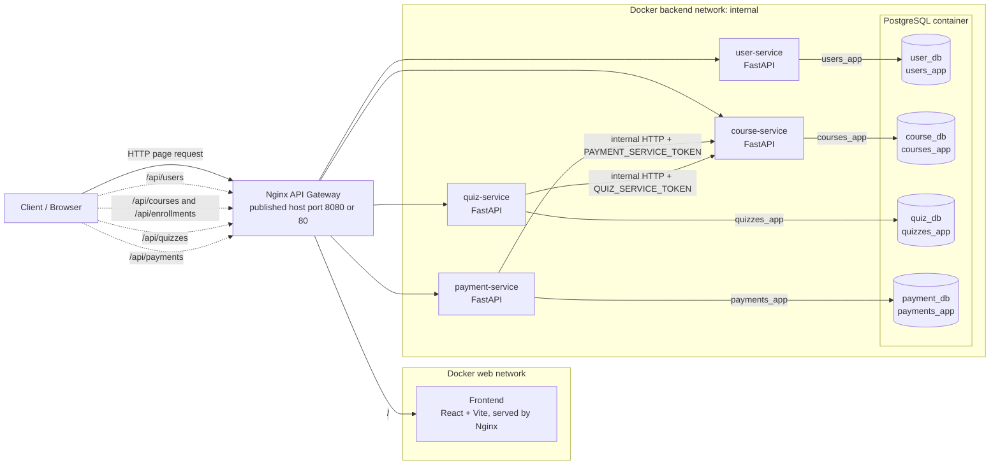

# Hướng dẫn cài đặt và giải thích kiến trúc OELP

> Tài liệu dành cho các thành viên trong nhóm và giảng viên chấm đồ án. Tài liệu mô tả kiến trúc đang được triển khai trong repo, cách chạy demo local, cách kiểm thử các API qua Nginx, quy tắc phát triển từng service và cách xử lý các lỗi phổ biến.

## 1. Kiến trúc tổng thể và luồng dữ liệu

OELP gồm một frontend React/Vite, một Nginx làm cổng vào duy nhất, bốn backend FastAPI và một PostgreSQL container. PostgreSQL là một server dùng chung cho demo, nhưng mỗi microservice có database và role riêng. Backend không truy cập database của service khác.



### 1.1. Định tuyến và cô lập mạng

Trình duyệt truy cập trang web và API qua cùng Nginx. Nginx chuyển `/` tới frontend; `/api/users` tới User Service; `/api/courses`, `/api/lessons`, `/api/enrollments` tới Course Service; `/api/quizzes` tới Quiz Service; và `/api/payments` tới Payment Service. Các route `/services/<service>/...` được giữ lại để kiểm tra health, readiness, tài liệu OpenAPI và demo.

Trong Compose, frontend nằm trên mạng `web`; các service backend và PostgreSQL nằm trên mạng `backend`, được đánh dấu `internal: true`. Nginx được nối với cả hai mạng để chuyển tiếp request. Chỉ Nginx có `ports:` publish ra host. Các service có cổng `8000` và PostgreSQL có cổng `5432` nhưng chỉ giao tiếp bằng DNS nội bộ Docker như `payment-service:8000` hoặc `postgres:5432`.

Không publish `8000` và `5432` ra host giúp tránh tạo đường truy cập vòng ngoài qua Nginx, giảm bề mặt tấn công và buộc mọi request API công khai đi qua một điểm vào duy nhất. Cổng `5432` cũng không bị mở ra Internet; mỗi service chỉ kết nối database của mình bằng role riêng. Khi chạy EC2, Security Group nên cho SSH `22` từ địa chỉ IP quản trị và chỉ mở cổng web `80` hoặc `8080` cần cho demo.

### 1.2. Xác thực JWT bất đối xứng RS256

User Service là nơi xác thực email/mật khẩu và phát hành access token. Khi đăng nhập thành công, service tạo JWT ký bằng thuật toán `RS256` và private key đọc từ `JWT_PRIVATE_KEY_PATH`. Các claim gồm danh tính `sub`, vai trò `role`, thời điểm phát hành/hết hạn và `iss`/`aud`.

Course, Quiz và Payment Service nhận cùng `JWT_PUBLIC_KEY_PATH`, `JWT_ISSUER` và `JWT_AUDIENCE`. Mỗi service tự xác minh chữ ký, thời hạn, issuer, audience, UUID người dùng và role trước khi chạy endpoint được bảo vệ. Chúng chỉ cần public key, không cần private key và không thể dùng public key để ký token hợp lệ. Compose chỉ mount private key vào User Service; public key được mount vào các service cần xác minh.

Việc phát hành token tập trung giúp thống nhất danh tính và role trên toàn hệ thống mà không yêu cầu mỗi service hỏi User Service cho mọi request. `learner` và `admin` được kiểm tra ở backend; Nginx chỉ định tuyến, không thay thế xác thực trong ứng dụng. Giữ `JWT_ISSUER`/`JWT_AUDIENCE` giống nhau ở toàn bộ service. Không gửi hoặc commit private key.

### 1.3. Thanh toán mô phỏng mở khóa khóa học

Luồng mua khóa học trả phí diễn ra như sau:

1. Người học gửi `POST /api/payments` qua Nginx, kèm JWT và `Idempotency-Key` dạng UUID. Body chỉ có `course_id`; frontend không được quyết định số tiền, user ID hay trạng thái.
2. Payment Service gọi nội bộ `GET /internal/courses/{course_id}/purchase` ở Course Service, gửi `X-Service-Token` bằng `PAYMENT_SERVICE_TOKEN`. Course Service xác nhận khóa học, giá hiện tại, tiền tệ, khóa học miễn phí hay trả phí và người học đã đăng ký chưa.
3. Nếu khóa học trả phí và chưa được đăng ký, Payment Service lưu giao dịch cùng số tiền lấy từ Course Service và event `PENDING`. Gửi lại cùng idempotency key cho cùng user/khóa học trả lại giao dịch cũ; dùng key đó cho khóa khác bị từ chối.
4. Trong demo, admin gọi `POST /api/payments/{id}/simulate-result` với `scenario=success` hoặc `scenario=failure`. Endpoint này chỉ dành cho admin và chỉ hoạt động khi `DEMO_MODE=true`. Đây là mô phỏng kết quả, không kết nối cổng thanh toán thật và không nhận dữ liệu thẻ.
5. Với `FAILED`, Payment Service ghi trạng thái cuối cùng và không gọi cấp quyền. Người học không được đăng ký khóa trả phí đó.
6. Với `SUCCESS`, Payment Service ghi trạng thái trước, sau đó gọi nội bộ `POST /internal/enrollments/confirm-payment` tại Course Service, tiếp tục xác thực `PAYMENT_SERVICE_TOKEN`. Request gồm payment ID, user ID, course ID, amount và currency.
7. Course Service đối chiếu lại giá/tiền tệ với dữ liệu khóa học, ghi receipt và enrollment trong database `course_db`. Callback có tính idempotent: gửi lại cùng payment không tạo enrollment trùng; cùng payment ID nhưng thông tin khác bị từ chối.
8. Nếu Course Service xác nhận thành công, Payment Service đánh dấu `enrollment_confirmed=true`, ghi event cấp quyền và trả `access_status=granted`. Nếu Course Service tạm thời không sẵn sàng, Payment Service vẫn giữ `SUCCESS`, trả HTTP `202` với trạng thái chờ xác nhận và cho phép retry để gửi lại callback an toàn.

Do đó, `SUCCESS` thể hiện kết quả mô phỏng đã ghi nhận; quyền truy cập chỉ được coi là đã cấp sau khi Course Service xác nhận enrollment. Trạng thái `PENDING` hoặc `FAILED` không mở quyền học.

## 2. Cài đặt và chạy local từng bước

### 2.1. Yêu cầu

- Git để lấy source code.
- Docker Engine + Docker Compose v2; trên Windows có thể dùng Docker Desktop với Linux containers.
- Bash: Bash/WSL hoặc Git Bash trên Windows; Bash có sẵn trên Linux/macOS.
- Python 3 để chạy script kiểm thử luồng thanh toán (chỉ dùng thư viện chuẩn Python).

### 2.2. Bước 1 — Tạo môi trường local và khóa JWT

Từ thư mục gốc của repo, chạy:

```bash
bash ./scripts/setup-env.sh
```

Script yêu cầu `openssl`, sau đó:

- Nếu `.env` chưa tồn tại, tạo file từ `.env.example`, thay mọi giá trị `CHANGE_ME` bằng chuỗi ngẫu nhiên và đặt quyền đọc file chỉ cho chủ sở hữu.
- Nếu `.env` đã tồn tại, giữ nguyên để không làm đổi mật khẩu database/demo ngoài ý muốn.
- Tạo `.secrets/` nếu chưa có, đặt thư mục ở quyền `0700`, rồi sinh private/public RSA 2048-bit nếu cả hai file chưa có.
- Nếu đã có cặp khóa, kiểm tra public key suy ra từ private key có khớp với public key đã lưu hay không. Nếu chỉ có một file hoặc cặp không khớp, script dừng và không tự ghi đè khóa.
- Đặt quyền private key phù hợp với Docker Compose file secret: thư mục `.secrets/` chỉ chủ sở hữu truy cập được; file khóa được mount để process non-root trong User Service đọc được. Private key chỉ được mount vào User Service.

`.env` và `.secrets/` được `.gitignore` loại trừ. Không gửi các file này lên GitHub. Nếu chỉnh `.env` bằng tay, giữ các giá trị mật khẩu/token không rỗng và bảo đảm `JWT_ISSUER`/`JWT_AUDIENCE` thống nhất giữa các service.

Mặc định `.env.example` bind Nginx vào `127.0.0.1:8080`, phù hợp demo local. Để máy khác truy cập, đặt `NGINX_BIND_ADDRESS=0.0.0.0` và cổng mong muốn trong `.env`, đồng thời cấu hình firewall/Security Group phù hợp. Không thay đổi quy tắc không publish cổng service hoặc PostgreSQL.

### 2.3. Bước 2 — Khởi động Compose

```bash
docker compose config --quiet
docker compose up -d --build
```

Compose khởi động PostgreSQL, đợi health check, sau đó khởi động bốn backend và frontend. Nginx chỉ khởi động khi các thành phần upstream đã healthy. PostgreSQL chạy `postgres-init/init-multiple-dbs.sql` khi khởi tạo **data volume rỗng lần đầu**, tạo `user_db`, `course_db`, `quiz_db`, `payment_db` cùng các role riêng.

`docker compose down` dừng và xóa container/network nhưng giữ named volume `postgres-data`; dữ liệu, tài khoản và schema vẫn còn. Chỉ dùng lệnh dưới đây khi muốn xóa toàn bộ dữ liệu demo để PostgreSQL chạy lại init script:

```bash
docker compose down -v
docker compose up -d --build
```

`down -v` xóa volume database của dự án; mọi tài khoản, payment, enrollment và kết quả quiz lưu trong volume sẽ mất. Không dùng lệnh này chỉ để rebuild code.

### 2.4. Bước 3 — Kiểm tra container và truy cập

```bash
docker compose ps
docker compose logs --tail=100
```

Trên máy local với port mặc định:

- Frontend: <http://localhost:8080>
- Health của gateway: <http://localhost:8080/health>
- Health của Payment Service qua Nginx: <http://localhost:8080/services/payments/health>
- Readiness của Payment Service, có kiểm tra database: <http://localhost:8080/services/payments/ready>
- Tài liệu API: `/services/users/docs`, `/services/courses/docs`, `/services/quizzes/docs`, `/services/payments/docs` dưới cùng base URL.

Nếu đã đổi `NGINX_HOST_PORT`, thay `8080` bằng giá trị trong `.env`. `/health` của gateway chỉ xác nhận Nginx đang hoạt động; endpoint `/services/<service>/ready` còn kiểm tra kết nối database của service đó.

## 3. Kiểm thử tự động và thủ công

### 3.1. Kiểm thử toàn luồng tự động

Sau khi Compose healthy, chạy ở thư mục gốc:

```bash
python scripts/test-payment-flow.py
```

Script dùng base URL `http://127.0.0.1:8080` mặc định; có thể đổi bằng `--base-url`, ví dụ `python scripts/test-payment-flow.py --base-url http://127.0.0.1:8081`. Script yêu cầu `DEMO_MODE=true`, demo admin credentials hợp lệ trong `.env` và có ít nhất một khóa học trả phí trong catalog đã seed.

Script tạo learner thử nghiệm mới, đăng nhập để lấy JWT, chọn khóa trả phí, tạo giao dịch, dùng demo admin để mô phỏng kết quả rồi kiểm tra quyền truy cập. Nó tạo learner thứ hai cho nhánh lỗi để chứng minh `FAILED` không mở quyền. Không in password hoặc JWT ra log. Kết quả mẫu được ghi vào [`payment-flow-sample.json`](payment-flow-sample.json):

- `gateway_health` và `payment_service_health`: health endpoint gateway/service trả `ok`.
- `created_payment_status`: giao dịch mới bắt đầu ở `PENDING`.
- `success_payment_status`, `success_access_status`, `success_enrollment_confirmed`: xác nhận thanh toán thành công và course enrollment đã được Course Service cấp.
- `failed_payment_status`, `failed_payment_granted_access`: nhánh lỗi kết thúc ở `FAILED` và không cấp quyền.
- `course_id`, `success_payment_id`, `failed_payment_id`: ID để tra cứu bản ghi trong lần chạy đó; mỗi lần chạy tạo ID mới và ghi đè file kết quả mẫu.

### 3.2. Kiểm thử thủ công bằng curl

Các ví dụ sau dùng Bash, curl và Python 3. Hãy chạy từ root repo. `.env` do script tạo chỉ chứa giá trị an toàn với cú pháp shell đơn giản; nạp biến để lấy port và demo admin credentials:

```bash
set -a
source .env
set +a
BASE_URL="http://localhost:${NGINX_HOST_PORT:-8080}"
curl -i "$BASE_URL/health"
curl -i "$BASE_URL/services/payments/health"
curl -i "$BASE_URL/services/payments/ready"
```

Tạo learner thử nghiệm và đăng nhập lấy token:

```bash
EMAIL="guide-$(date +%s)-$RANDOM@example.test"
PASSWORD='LocalDemoPass123!'

curl -sS -X POST "$BASE_URL/api/users/register" \
  -H 'Content-Type: application/json' \
  -d "{\"email\":\"$EMAIL\",\"password\":\"$PASSWORD\",\"display_name\":\"Guide Learner\"}"

LOGIN_JSON="$(curl -sS -X POST "$BASE_URL/api/users/login" \
  -H 'Content-Type: application/json' \
  -d "{\"email\":\"$EMAIL\",\"password\":\"$PASSWORD\"}")"
TOKEN="$(printf '%s' "$LOGIN_JSON" | python3 -c 'import json,sys; print(json.load(sys.stdin)["access_token"])')"
curl -sS "$BASE_URL/api/users/me" -H "Authorization: Bearer $TOKEN"
```

Liệt kê khóa học. Với catalog demo ban đầu, khóa `1` miễn phí, khóa `2` trả phí (149000 VND); nếu nhóm thay seed data, lấy ID/giá từ phản hồi thay vì giả định các giá trị này.

```bash
curl -sS "$BASE_URL/api/courses"
curl -sS "$BASE_URL/api/courses/2"
```

Đăng ký khóa miễn phí `1`, lấy quiz `1` và nộp đáp án minh họa. Quiz service tự chấm điểm; client không gửi điểm:

```bash
curl -sS -X POST "$BASE_URL/api/enrollments" \
  -H "Authorization: Bearer $TOKEN" -H 'Content-Type: application/json' \
  -d '{"course_id":1}'
curl -sS "$BASE_URL/api/quizzes/1" -H "Authorization: Bearer $TOKEN"
curl -sS -X POST "$BASE_URL/api/quizzes/1/submit" \
  -H "Authorization: Bearer $TOKEN" -H 'Content-Type: application/json' \
  -d '{"answers":{"11":"a","12":"from"}}'
```

Tạo payment `PENDING` cho khóa trả phí `2`. Idempotency key phải là UUID mới cho giao dịch mới:

```bash
IDEMPOTENCY_KEY="$(python3 -c 'import uuid; print(uuid.uuid4())')"
PENDING_JSON="$(curl -sS -X POST "$BASE_URL/api/payments" \
  -H "Authorization: Bearer $TOKEN" \
  -H "Idempotency-Key: $IDEMPOTENCY_KEY" \
  -H 'Content-Type: application/json' \
  -d '{"course_id":2}')"
printf '%s\n' "$PENDING_JSON"
PAYMENT_ID="$(printf '%s' "$PENDING_JSON" | python3 -c 'import json,sys; print(json.load(sys.stdin)["transaction"]["id"])')"
```

Đăng nhập demo admin từ `.env`, mô phỏng `SUCCESS`, rồi tra giao dịch và enrollment:

```bash
ADMIN_LOGIN_JSON="$(python3 -c 'import json,os; print(json.dumps({"email":os.environ["DEMO_ADMIN_EMAIL"],"password":os.environ["DEMO_ADMIN_PASSWORD"]}))')"
ADMIN_LOGIN="$(curl -sS -X POST "$BASE_URL/api/users/login" \
  -H 'Content-Type: application/json' -d "$ADMIN_LOGIN_JSON")"
ADMIN_TOKEN="$(printf '%s' "$ADMIN_LOGIN" | python3 -c 'import json,sys; print(json.load(sys.stdin)["access_token"])')"

curl -sS -X POST "$BASE_URL/api/payments/$PAYMENT_ID/simulate-result" \
  -H "Authorization: Bearer $ADMIN_TOKEN" -H 'Content-Type: application/json' \
  -d '{"scenario":"success"}'
curl -sS "$BASE_URL/api/payments/$PAYMENT_ID" -H "Authorization: Bearer $TOKEN"
curl -sS "$BASE_URL/api/enrollments/my-courses" -H "Authorization: Bearer $TOKEN"
curl -sS "$BASE_URL/api/payments/my-transactions" -H "Authorization: Bearer $TOKEN"
```

Phản hồi simulation thành công cần có `transaction.status="SUCCESS"` và `access_status="granted"`; giao dịch cần `enrollment_confirmed=true`, khóa `2` xuất hiện trong `/api/enrollments/my-courses`. Để thử `FAILED`, dùng learner mới (không có enrollment ở khóa 2), đăng ký/đăng nhập learner đó, tạo payment mới với UUID idempotency khác rồi dùng lại `ADMIN_TOKEN`:

```bash
FAIL_EMAIL="guide-failed-$(date +%s)-$RANDOM@example.test"
FAIL_PASSWORD='LocalDemoPass123!'
curl -sS -X POST "$BASE_URL/api/users/register" \
  -H 'Content-Type: application/json' \
  -d "{\"email\":\"$FAIL_EMAIL\",\"password\":\"$FAIL_PASSWORD\",\"display_name\":\"Failed Payment Learner\"}"
FAIL_LOGIN="$(curl -sS -X POST "$BASE_URL/api/users/login" \
  -H 'Content-Type: application/json' \
  -d "{\"email\":\"$FAIL_EMAIL\",\"password\":\"$FAIL_PASSWORD\"}")"
FAIL_TOKEN="$(printf '%s' "$FAIL_LOGIN" | python3 -c 'import json,sys; print(json.load(sys.stdin)["access_token"])')"
FAIL_KEY="$(python3 -c 'import uuid; print(uuid.uuid4())')"
FAIL_PAYMENT="$(curl -sS -X POST "$BASE_URL/api/payments" \
  -H "Authorization: Bearer $FAIL_TOKEN" -H "Idempotency-Key: $FAIL_KEY" \
  -H 'Content-Type: application/json' -d '{"course_id":2}')"
FAIL_ID="$(printf '%s' "$FAIL_PAYMENT" | python3 -c 'import json,sys; print(json.load(sys.stdin)["transaction"]["id"])')"
curl -sS -X POST "$BASE_URL/api/payments/$FAIL_ID/simulate-result" \
  -H "Authorization: Bearer $ADMIN_TOKEN" -H 'Content-Type: application/json' \
  -d '{"scenario":"failure"}'
curl -sS "$BASE_URL/api/payments/$FAIL_ID" -H "Authorization: Bearer $FAIL_TOKEN"
curl -sS "$BASE_URL/api/enrollments/my-courses" -H "Authorization: Bearer $FAIL_TOKEN"
```

Giao dịch cuối phải có `status="FAILED"`; danh sách enrollment của learner thất bại không được chứa `course_id=2`. Endpoint mô phỏng là chức năng demo admin-only, không phải callback từ cổng thanh toán thật.

## 4. Hướng dẫn phát triển tiếp cho Thành viên 1 và 2

Các source code backend được đóng gói trong image; sau khi sửa code, build và recreate đúng service bằng lệnh:

```bash
docker compose up -d --build user-service
docker compose up -d --build course-service
docker compose up -d --build quiz-service
docker compose up -d --build frontend
```

Chạy một lệnh tương ứng với service vừa sửa. Compose sẽ build image mới, recreate service đó và áp dụng healthcheck/`depends_on`; không xóa named volume. Nếu sửa Nginx, dùng `docker compose up -d nginx`; nếu sửa Compose/env, kiểm tra `docker compose config --quiet` rồi `docker compose up -d` để áp dụng cấu hình.

Mỗi service sở hữu dữ liệu của chính nó:

| Service | Database | Role |
| --- | --- | --- |
| User Service | `user_db` | `users_app` |
| Course Service | `course_db` | `courses_app` |
| Quiz Service | `quiz_db` | `quizzes_app` |
| Payment Service | `payment_db` | `payments_app` |

Khi cần thay đổi schema, sửa migration mới trong thư mục migration của service sở hữu database đó; không sửa schema hoặc ghi trực tiếp vào database của service khác. Gọi API nội bộ đã thống nhất để chia sẻ nghiệp vụ. Ví dụ, Quiz Service hỏi Course Service về quyền truy cập quiz; Payment Service lấy giá/xác nhận payment qua Course Service.

Không commit `.env`, `.secrets/`, private key, token liên-service hoặc dữ liệu đăng nhập. Trước khi commit, kiểm tra `git status --ignored`, `git check-ignore .env .secrets/jwt-private.pem` và rà soát diff để không đưa bí mật vào source.

## 5. FAQ xử lý lỗi thường gặp

| Triệu chứng | Nguyên nhân thường gặp | Cách xử lý |
| --- | --- | --- |
| `user_db`, `payment_db` hoặc database khác không tồn tại | PostgreSQL đã có volume cũ; file init chỉ chạy khi data directory trống. | Nếu có thể xóa dữ liệu demo, chạy `docker compose down -v` rồi `docker compose up -d --build`. Lệnh này xóa toàn bộ database trong volume; sao lưu trước nếu cần giữ dữ liệu. |
| API trả `401 invalid_token` | Token hết hạn, bị cắt/sửa, issuer/audience không đồng nhất hoặc token được ký bởi private key khác public key của service. | Đăng nhập lại để lấy token mới; kiểm tra `JWT_ISSUER` và `JWT_AUDIENCE` trong `.env`; xác minh cặp key bằng `bash ./scripts/setup-env.sh`; xem `docker compose logs user-service payment-service course-service quiz-service`. |
| User Service báo không đọc được `jwt_private_key` hoặc service báo lỗi public `.pem` | Key thiếu, volume mount sai đường dẫn hoặc quyền file khiến process non-root không đọc được. | Chạy `bash ./scripts/setup-env.sh` để kiểm tra cặp key và chuẩn hóa quyền. Giữ `.secrets/` ở quyền owner-only (`0700`) và file key ở quyền Compose mount đọc được (`0644` theo script); không đặt private key thành `0600` nếu Compose file-secret mount của bạn đang cấp file cho root và service chạy non-root. Kiểm tra `OELP_SECRET_DIR` trong `.env` và đường dẫn file trong Compose. |
| `docker compose up` báo `port is already allocated` hoặc không mở được 8080 | Ứng dụng khác đang chiếm host port. | Chọn một host port trống trong `.env`, ví dụ `NGINX_HOST_PORT=8081`, rồi chạy `docker compose up -d nginx`. Truy cập `http://localhost:8081`. Container vẫn nghe cổng 80 nội bộ. |
| Container backend `unhealthy` | PostgreSQL chưa sẵn sàng, mật khẩu `.env` vẫn là placeholder, migration lỗi hoặc key chưa mount. | Chạy `docker compose ps`, sau đó `docker compose logs --tail=100 <service>`; kiểm tra `.env` đã thay `CHANGE_ME`, Postgres healthy và file key đúng. Khởi động lại bằng `docker compose up -d <service>` sau khi xử lý. |
| Payment là `SUCCESS` nhưng `enrollment_confirmed=false` | Course Service tạm thời không nhận được callback hoặc từ chối xác nhận giá/tiền tệ. | Đọc log `payment-service` và `course-service`, kiểm tra `PAYMENT_SERVICE_TOKEN` giống nhau ở hai service và course price/currency chưa đổi. Nếu Course Service tạm thời unavailable, gọi lại endpoint admin `/simulate-result` với `scenario=success` để retry callback idempotent. |
| Nginx chạy nhưng API trả `502` | Upstream chưa healthy, tên service/route sai hoặc backend vừa được recreate. | Kiểm tra `docker compose ps`, `docker compose logs nginx <service>` và health endpoint của upstream. Compose dùng DNS service name nên không hard-code IP container. |

