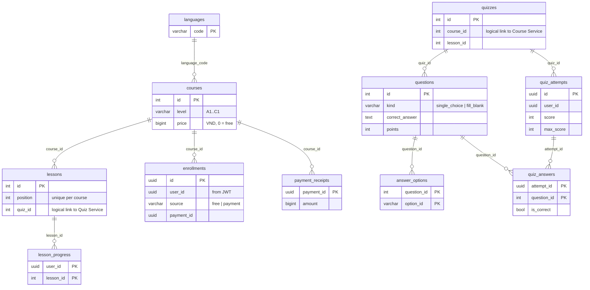
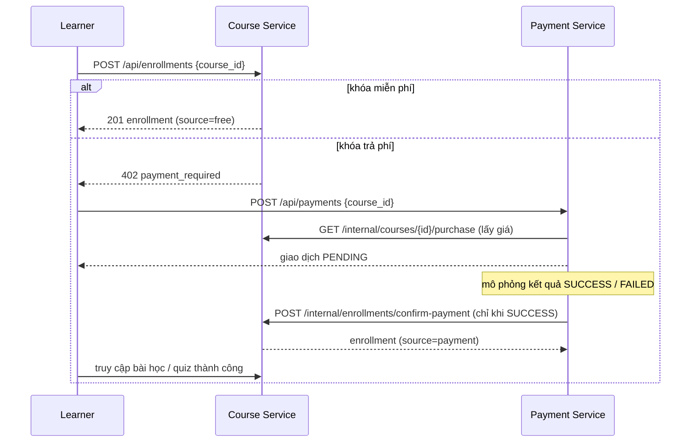

# Thiết kế dữ liệu và luồng nghiệp vụ: Course Service + Quiz Service

## 1. Nguyên tắc

- Mỗi service có **database riêng** trên cùng một PostgreSQL instance (`courses_db`, `quizzes_db`), mỗi database có role riêng (`courses_app`, `quizzes_app`). Không service nào đọc database của service khác.
- Các bảng của hai service liên kết với nhau bằng **ID logic** (không có khóa ngoại xuyên database), vì thế mọi kiểm tra chéo đi qua API nội bộ.
- Danh tính người dùng (`user_id`) luôn lấy từ JWT, không nhận từ body.

## 2. Sơ đồ dữ liệu

Liên kết logic giữa hai database: `lessons.quiz_id` → `quizzes.id`, `quizzes.course_id` / `quizzes.lesson_id` → `courses.id` / `lessons.id`, `enrollments.user_id` và `quiz_attempts.user_id` → người dùng của User Service.

Ràng buộc chính: `UNIQUE(user_id, course_id)` ở `enrollments` (không đăng ký trùng); `UNIQUE(course_id, position)` ở `lessons`; `UNIQUE(quiz_id, position)` ở `questions`; `CHECK price >= 0`, `CHECK currency = 'VND'`, `CHECK level IN (A1..C1)`.

Migration nằm ở `services/*/migrations/001_initial.sql`. Hệ thống ghi checksum vào `schema_migrations`; **không sửa file đã áp dụng**, muốn đổi cấu trúc thì thêm `002_...sql`.

## 3. Dữ liệu demo

| Khóa | Cấp độ | Giá | Quiz |
| --- | --- | --- | --- |
| English First Steps | A1 | Miễn phí | 1 |
| Everyday English | A2 | 149.000 VND | 2 |
| English at Work | B1 | 249.000 VND | 3 |
| 5 khóa A1–C1 bổ sung | A1–C1 | Miễn phí | 4–8 (10 câu/quiz) |

Tổng: 8 khóa, 21 bài, 8 quiz, 56 câu. Có cả khóa miễn phí và trả phí để demo đủ luồng. Seed chỉ thêm bản ghi còn thiếu (`ON CONFLICT DO NOTHING`).

## 4. Quy tắc truy cập

| Hành động | Ai được phép |
| --- | --- |
| Xem danh sách/chi tiết khóa, mục lục bài | Mọi người |
| Xem nội dung bài, đánh dấu hoàn thành | Người đã có `enrollment` của khóa (admin: luôn được) |
| Xem đề, nộp bài, xem kết quả | Người đã có `enrollment` của khóa chứa quiz |
| Tạo khóa/bài/quiz | Admin |

Quiz Service hỏi Course Service `GET /internal/courses/{id}/access?user_id=` (kèm `X-Service-Token`) để biết người dùng đã đăng ký chưa. Nếu Course Service không phản hồi, Quiz Service trả `503`, **không** tự cho phép truy cập.

## 5. Quy tắc thanh toán và mở quyền học

- Khóa trả phí **chỉ** mở quyền khi Payment Service báo `SUCCESS`. Giao dịch `FAILED` không tạo enrollment.
- Course Service tự kiểm tra `amount` và `currency` khớp giá khóa học, không tin hoàn toàn Payment Service.
- `confirm-payment` an toàn khi gọi lặp (cùng `payment_id` trả `replayed: true`).
- Mọi giao dịch là mô phỏng, không có dữ liệu thẻ.

## 6. Xử lý lỗi

| Tình huống | Kết quả |
| --- | --- |
| Chưa đăng nhập / token sai hoặc hết hạn | `401` |
| Học bài hoặc làm quiz khi chưa đăng ký | `403 enrollment_required` |
| Đăng ký khóa trả phí khi chưa thanh toán | `402 payment_required` |
| Nộp bài thiếu/thừa câu, sai đáp án không thuộc lựa chọn, gửi kèm `score` | `422`, không lưu |
| Số tiền thanh toán không khớp giá | `409 payment_mismatch` |
| Course Service ngừng hoạt động khi làm quiz | `503 course_service_unavailable` |
